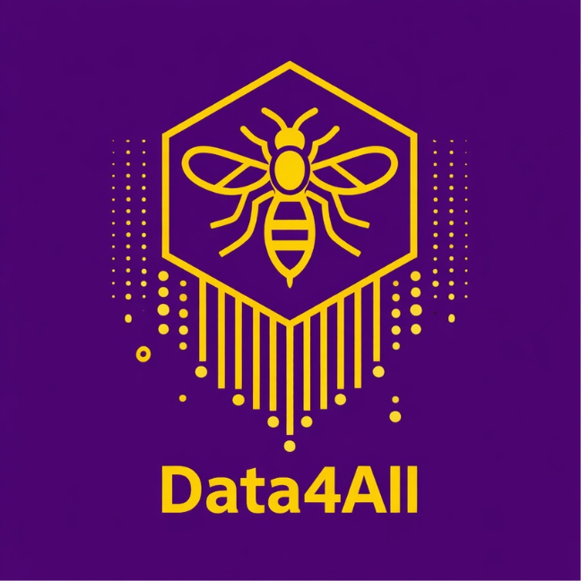
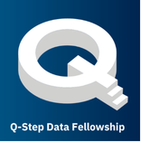
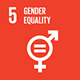
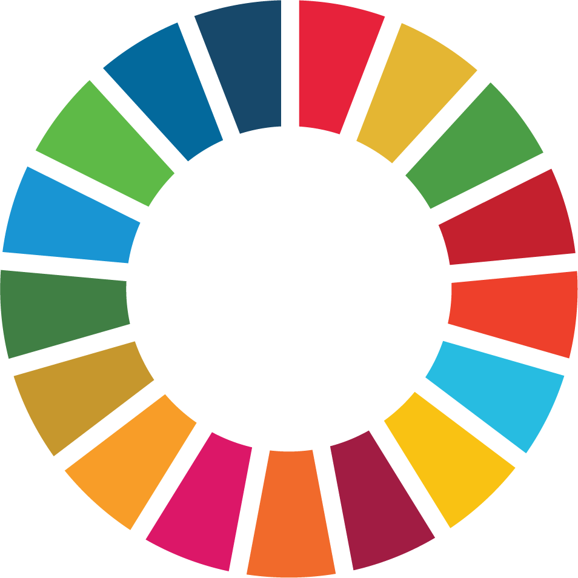

## {#launch .cover data-background-color="#30204a"}

<svg class="logo-filters" xmlns="http://www.w3.org/2000/svg" aria-hidden="true">
  <defs>
    <filter id="bee-mask" color-interpolation-filters="sRGB"><feColorMatrix type="matrix" values="1 0 0 0 0  0 1 0 0 0  0 0 1 0 0  0 2.4 0 0 -.35"/></filter>
    <filter id="qstep-mask" color-interpolation-filters="sRGB"><feColorMatrix type="matrix" values="1 0 0 0 0  0 1 0 0 0  0 0 1 0 0  2 0 0 0 -.22"/></filter>
  </defs>
</svg>

Data4All 2026 · Morning Data Lab · 25 November

<h1>Who might a mobile-first grant leave behind?</h1>

You’re advising a council. Use a spreadsheet to explore phone ownership in one country, make one chart and recommend one action. No coding or prior data experience needed.

## You are advising a fictional council

Choose **one country** from the spreadsheet. Imagine a council serves a local area there.

It is launching a grant to help households pay for essentials. The main way to apply is a form designed for mobile phones.

**Should it offer help by phone or in person from day one?**

Your team will use the data to suggest **one way to help residents apply**.

## Read the numbers

Open **02 Student spreadsheet.xlsx** and go to **Compare**.

- Choose **one country**. Read its female and male ownership rates.
- **60% means 60 out of every 100 people in that group.**
- Compare the two rates. Also look at the share without a phone.

The data are for **2024**, cover **people aged 5 and older**, and include basic phones and smartphones.

::: {.prompt}
Ask what the council still needs to learn about **eligible local adults** and their ability to complete the application.
:::

## A worked example from Belize

Mobile phone ownership (%) · Ages 5+ · 2024

<svg class="chart" viewBox="0 0 1060 338" role="img" aria-labelledby="chart-title chart-desc" xmlns="http://www.w3.org/2000/svg">
<title id="chart-title">Mobile phone ownership in Belize by sex</title>
<desc id="chart-desc">In Belize, 72.7 percent of the female group and 68.7 percent of the male group own a mobile phone. Ages 5 and older, 2024.</desc>
<g font-family="Arial, sans-serif" fill="#261939" font-size="24">
<text x="6" y="102">Female</text><text x="6" y="207">Male</text>
<rect x="191" y="65" width="523.44" height="48" rx="3" fill="#5d3787"/>
<rect x="191" y="170" width="494.64" height="48" rx="3" fill="#006a67"/>
<text x="730" y="99">72.7%</text><text x="701" y="204">68.7%</text>
<path d="M191 38V253H911" fill="none" stroke="#675a73" stroke-width="2"/>
<g text-anchor="middle"><text x="191" y="288">0</text><text x="371" y="288">25</text><text x="551" y="288">50</text><text x="731" y="288">75</text><text x="911" y="288">100%</text></g>
</g>
</svg>

::: {.prompt}
The female rate is 4 percentage points higher. About **27 in 100** in the female group and **31 in 100** in the male group lack their own phone.
:::

[UN Global SDG Indicators Database / ITU · Indicator 5.b.1](https://unstats.un.org/sdgs/dataportal/database){.small}

## Make one slide together

1. **Make one chart** showing female and male ownership in your chosen country. Add a clear title, labels, % and the source.
2. **Suggest one way the council could help people apply.** Say who it helps and at which step.
3. **Show your idea beside the chart.** Choose a sketch, message, simple diagram or short resident example.

::: {.prompt}
For example, a library drop-in could help residents scan and upload documents. A sample invitation could show how residents would hear about it.
:::

## Add 3-5 sentences below your slide

In PowerPoint, open the **Notes** area below the slide.

- Give the **female and male rates**, with %.
- Explain **your idea**, who it helps and why you chose it.
- Give **one question to ask eligible local adults**.
- Say **how the council could check whether the help works**.

::: {.prompt}
Use the **student brief** for the full instructions and the **slide template** to build your submission.
:::

## Sources and background

[**UN Global SDG Indicators Database / ITU**](https://unstats.un.org/sdgs/dataportal/database)  
Indicator 5.b.1 · mobile phone ownership by sex · 2024 figures.

[**Indicator definition and methodology**](https://unstats.un.org/sdgs/metadata/files/Metadata-05-0B-01.pdf) · [**Raw data extract**](https://unstats.un.org/SDGAPI/v1/sdg/Series/Data?seriesCode=IT_MOB_OWN&pageSize=10000)  
The workbook records original reporters and selection rules on **UN data**.

<a href="https://www.undp.org/genderequality">UNDP’s global gender equality work</a>

::: {.credits}
The content of this presentation has not been approved by the United Nations and does not reflect the views of the United Nations or its officials or Member States.
:::

## Good luck! {.lab-closing}

**Form groups of up to five. Open the spreadsheet and choose one country.**

10:30-11:20 - Create your slide  
11:20-11:35 - Swap drafts and give feedback  
11:35-12:00 - Revise and submit **one .pptx with brief notes**
 
The winning team gives a **three-minute afternoon talk**.

::: {style="display:flex; gap:32px; align-items:center; justify-content:center;"}
[{width=100px}](https://sdgs.un.org/goals/goal5)

[{width=100px}](https://www.un.org/sustainabledevelopment/)
:::
