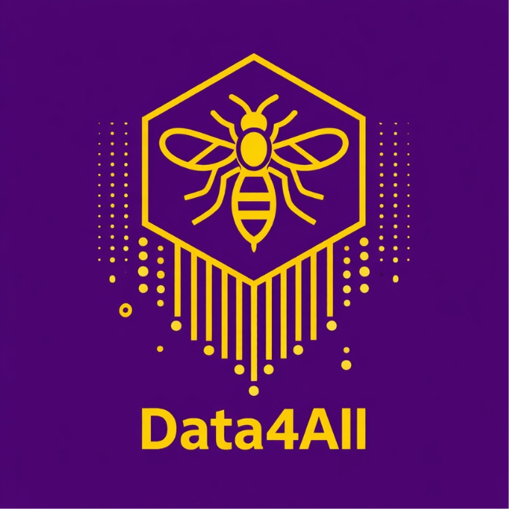
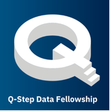
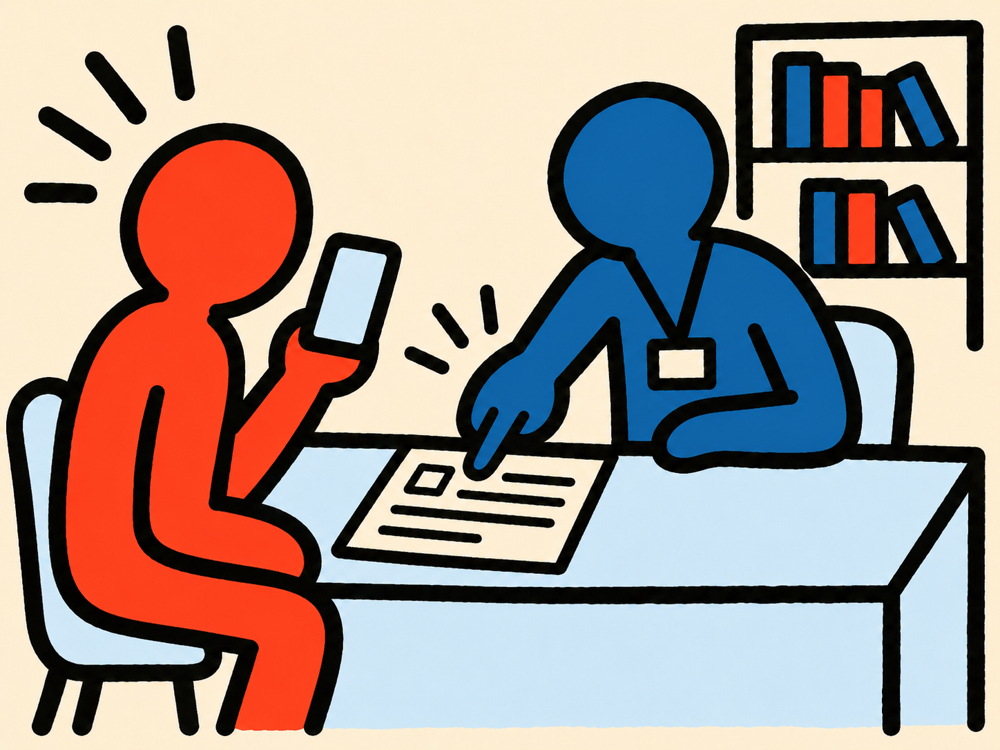
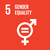
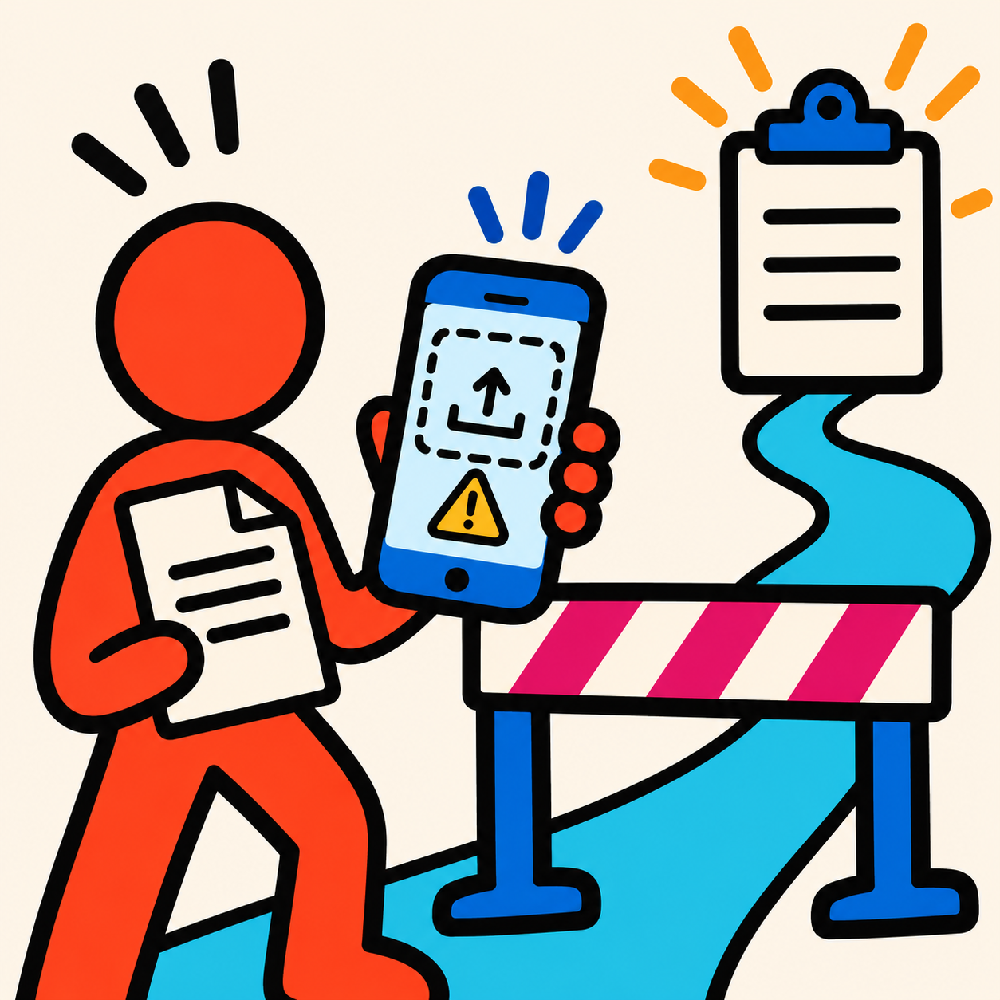
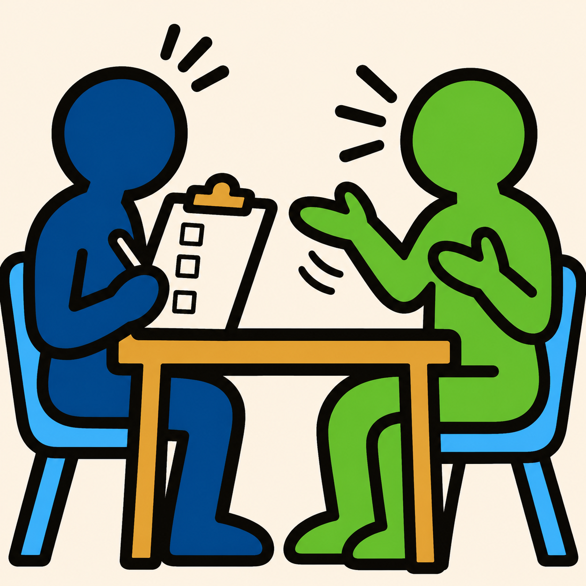
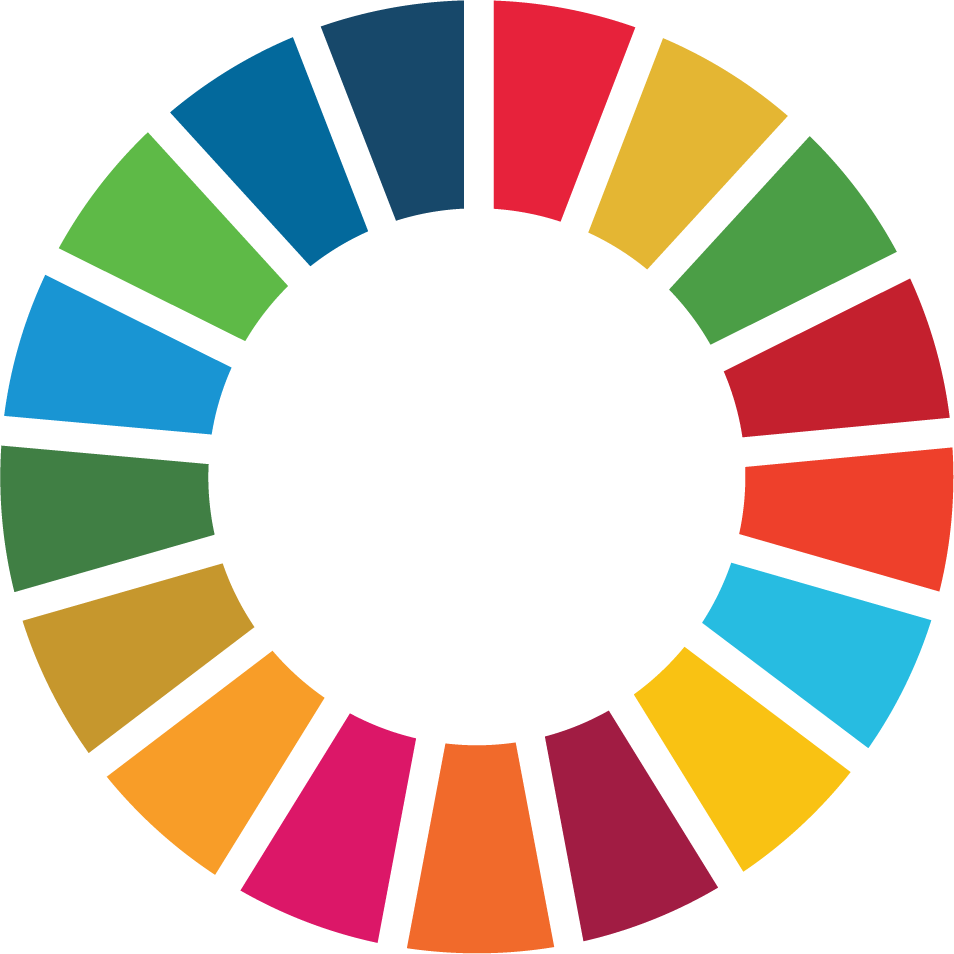

## {#launch .cover data-background-color="#30204a"}

<svg class="logo-filters" xmlns="http://www.w3.org/2000/svg" aria-hidden="true">
  <defs>
    <filter id="bee-mask" color-interpolation-filters="sRGB"><feColorMatrix type="matrix" values="1 0 0 0 0  0 1 0 0 0  0 0 1 0 0  0 2.4 0 0 -.35"/></filter>
    <filter id="qstep-mask" color-interpolation-filters="sRGB"><feColorMatrix type="matrix" values="1 0 0 0 0  0 1 0 0 0  0 0 1 0 0  2 0 0 0 -.22"/></filter>
  </defs>
</svg>

Data4All 2026 · Morning Data Lab · 25 November

<h1>Who might a mobile-first grant leave behind?</h1>

You’re advising a council. Use a spreadsheet to compare two countries, make one chart and recommend one action. No coding or prior data experience needed.

## The council’s decision

A fictional council is offering a grant to help households with essentials. It plans to make an online form designed for mobile phones the main way to apply. **Should residents also be able to apply with help by phone or in person from day one?**

1. Open the spreadsheet and choose **two countries**.
2. Compare their phone ownership rates and make **one chart**.
3. Design **one practical change** for the council and say how you’d test it.

::: {.prompt}
Hand in **one PowerPoint slide** with the chart and **3–5 short sentences** in the speaker notes.
:::

## What STEM and the humanities can do together

::: {.cards}
::: {.card}
**STEM and data skills**

Measure a pattern, compare groups and test whether a proposed solution works.
:::

::: {.card}
**Humanities and social science perspectives**

Ask whose experience is represented, what the numbers mean in context and what a fair response would look like.
:::
:::

::: {.prompt}
For this grant, we’ll use phone ownership data to spot a possible barrier. Listening to eligible residents could tell the council where they get stuck and what kind of help would make a difference.
:::

## Two applicants and one decision

::: {.cards}
::: {.card}
<svg class="card-icon" viewBox="0 0 98 72" aria-hidden="true" xmlns="http://www.w3.org/2000/svg">
<path d="M7 26l10 4M12 14l8 7M78 22l10-8M81 33l10-2" fill="none" stroke="#21182a" stroke-width="3" stroke-linecap="round"/>
<rect x="26" y="3" width="43" height="65" rx="9" fill="#f9c748" stroke="#21182a" stroke-width="4"/>
<rect x="33" y="10" width="29" height="20" rx="3" fill="#fff8e8" stroke="#21182a" stroke-width="2"/>
<path d="M35 39h4m7 0h4m7 0h4M35 47h4m7 0h4m7 0h4M35 55h4m7 0h4m7 0h4" stroke="#21182a" stroke-width="3" stroke-linecap="round"/>
</svg>

**Sam owns a basic phone.**

The grant application asks Sam to upload a photo of a document.
:::

::: {.card}
<svg class="card-icon" viewBox="0 0 98 72" aria-hidden="true" xmlns="http://www.w3.org/2000/svg">
<path d="M7 26l10 4M12 14l8 7M78 22l10-8M81 33l10-2" fill="none" stroke="#21182a" stroke-width="3" stroke-linecap="round"/>
<rect x="26" y="3" width="43" height="65" rx="9" fill="#45baac" stroke="#21182a" stroke-width="4"/>
<rect x="33" y="10" width="29" height="47" rx="4" fill="#fff8e8" stroke="#21182a" stroke-width="2"/>
<path d="M39 22h17M39 30h17M39 38h17M39 46h10" stroke="#21182a" stroke-width="3" stroke-linecap="round"/>
<circle cx="47.5" cy="62" r="2.2" fill="#21182a"/>
</svg>

**Alex borrows a smartphone.**

Alex can open the form but has to return the phone before finishing it.
:::
:::

::: {.prompt}
**Vote before seeing any data.** Should the council offer help by phone or in person from day one? What tipped your vote?
:::

## What are data?

**Data are recorded answers or observations.** Imagine asking ten people: “Do you own a mobile phone?” Each answer is one piece of data.

::: {.cards}
::: {.card .data-demo}
**The answers**

6 people say yes. 4 say no.

<svg viewBox="0 0 350 38" width="350" height="38" aria-hidden="true" xmlns="http://www.w3.org/2000/svg">
<g fill="#006a67"><circle cx="17" cy="19" r="12"/><circle cx="52" cy="19" r="12"/><circle cx="87" cy="19" r="12"/><circle cx="122" cy="19" r="12"/><circle cx="157" cy="19" r="12"/><circle cx="192" cy="19" r="12"/></g>
<g fill="#fff" stroke="#5d3787" stroke-width="3"><circle cx="227" cy="19" r="11"/><circle cx="262" cy="19" r="11"/><circle cx="297" cy="19" r="11"/><circle cx="332" cy="19" r="11"/></g>
</svg>

**The percentage**

6 out of 10 is 60 out of 100, or **60%**.
:::

::: {.card .data-demo}
**What to ask before comparing**

Who answered? How many people were asked? What did “own” mean? What question would you ask next?
:::
:::

::: {.prompt}
If two of the four people who said no regularly borrow a phone, what would you learn by asking about **access** as well as **ownership**?
:::

## What can one statistic make visible?

Belize · Mobile phone ownership · 2024 · Ages 5 and older

<strong>What we can see</strong>

<strong>72.7%</strong>Female

<strong>68.7%</strong>Male

Comparing the two rates reveals a 4 percentage point gap.

<strong>What the figures leave open</strong>

How many eligible adults can borrow a phone, use it privately or finish the grant form?

Children and adults are grouped together. Under-fives are outside this age range.

::: {.prompt}
**Think of someone who counts as a phone owner and could still struggle to apply. What would the council need to ask them?**
:::

[UN SDG 5.b.1 data extract](https://unstats.un.org/SDGAPI/v1/sdg/Series/Data?seriesCode=IT_MOB_OWN&pageSize=10000){.small}

## What would the council need to know?

The council plans to make the **mobile application the main route**. It wants your advice on whether to offer an assisted route from launch.

1. What might stop someone before they even open the form?
2. Where might they get stuck after starting it?
3. What could a phone or in-person route help them do?

::: {.prompt}
Agree on one barrier you would want the council to investigate.
:::

## Gender equality and digital inclusion

A mobile-first service makes a device part of the route to public support. People need the means to **start, complete and submit** the application.

<svg class="pathway" viewBox="0 0 1100 117" role="img" aria-labelledby="pathway-title" xmlns="http://www.w3.org/2000/svg">
<title id="pathway-title">Three stages of an application: start, complete and submit</title>
<g font-family="Arial, sans-serif" font-size="25" font-weight="bold" text-anchor="middle">
<rect x="5" y="20" width="310" height="76" rx="14" fill="#5d3787"/><text x="160" y="67" fill="#ffffff">1 · Start</text>
<rect x="395" y="20" width="310" height="76" rx="14" fill="#5d3787"/><text x="550" y="67" fill="#ffffff">2 · Complete</text>
<rect x="785" y="20" width="310" height="76" rx="14" fill="#006a67"/><text x="940" y="67" fill="#ffffff">3 · Submit</text>
<path d="M333 58h42m-10-10 10 10-10 10m358-10h42m-10-10 10 10-10 10" fill="none" stroke="#5d3787" stroke-width="4" stroke-linecap="round" stroke-linejoin="round"/>
</g>
</svg>

::: {.cards}
::: {.card}
**Gender equality**

Who has the resources and freedom to act? Think about who can use a device privately, decide how to spend money on data, or find time to apply.
:::

::: {.card}
**Digital inclusion**

Can someone use the service in practice? Think about a suitable device, connectivity, skills, accessibility and help when something goes wrong.
:::
:::

## How does an idea become a number?

| Step | Example from the Data Lab |
|:--|:--|
| **Concept** | Digital inclusion. Who can use technology to participate? |
| **Indicator** | Mobile phone ownership. A measurable part of access to technology. |
| **Observation** | One percentage for a country, year and reported sex group. |

::: {.prompt}
If a dashboard tracked only phone ownership, which barrier from the opening cases would disappear from view?
:::

## What does the UN count?

**UN Sustainable Development Goal 5** concerns gender equality. Target 5.b focuses on using enabling technology to support women’s empowerment. **Indicator 5.b.1** measures the percentage of people who own a mobile phone, reported by sex. The definition includes basic phones and smartphones with an active SIM for personal use.

::: {.cards}
::: {.card}
**Who is counted?**  
In our selected countries, the figures cover people aged **5 and older**. The female group includes girls and women. The male group includes boys and men.
:::

::: {.card}
**When?**  
**2024** is the reference year for all comparisons. The extract gives no exact fieldwork dates for these records.
:::
:::

[UN indicator definition and methodology](https://unstats.un.org/sdgs/metadata/files/Metadata-05-0B-01.pdf){.small}

## Who collected it, and for what purpose?

National organisations collect the figures. The **International Telecommunication Union** compiles them for global monitoring of digital gender inequality.

- Find the **Original reporter** column in the workbook’s **UN data** tab.
- Name one group or experience that the national figures leave hard to see.
- What would the council collect if its aim were to find out **where eligible adults get stuck**?

[UN indicator methodology](https://unstats.un.org/sdgs/metadata/files/Metadata-05-0B-01.pdf){.small}

## Three ways people disappear from a chart

| What happens | Example | Question for the council |
|:--|:--|:--|
| **Outside the survey population** | Children under five are outside the selected age range. | Who should be in scope for the grant decision? |
| **Combined into one figure** | Children and adults contribute to the same published rates. | Would the pattern look different for eligible adults? |
| **Experience missing from the measure** | The ownership rate cannot show whether someone can upload a document privately. | How could we hear from people who never started the form? |

## Read the rates before judging the gap

Worked example · Individuals aged 5+ who own a mobile phone (%) · 2024

<svg class="chart" viewBox="0 0 1060 338" role="img" aria-labelledby="chart-title chart-desc" xmlns="http://www.w3.org/2000/svg">
<title id="chart-title">Mobile phone ownership in Belize and Côte d’Ivoire by sex</title>
<desc id="chart-desc">In Belize, 72.7 percent female and 68.7 percent male. In Côte d’Ivoire, 61.8 percent female and 68.8 percent male. Bars start at zero.</desc>
<g font-family="Arial, sans-serif" fill="#261939" font-size="22">
<text x="6" y="87" font-weight="bold">Belize</text><text x="6" y="203" font-weight="bold">Côte d’Ivoire</text>
<rect x="191" y="43" width="523.44" height="32" rx="3" fill="#5d3787"/>
<rect x="191" y="83" width="494.64" height="32" rx="3" fill="#006a67"/>
<rect x="191" y="159" width="444.96" height="32" rx="3" fill="#5d3787"/>
<rect x="191" y="199" width="495.36" height="32" rx="3" fill="#006a67"/>
<text x="727" y="66">72.7</text><text x="697" y="106">68.7</text><text x="648" y="182">61.8</text><text x="698" y="222">68.8</text>
<path d="M191 38V253H911" fill="none" stroke="#675a73" stroke-width="2"/>
<g text-anchor="middle"><text x="191" y="283">0</text><text x="371" y="283">25</text><text x="551" y="283">50</text><text x="731" y="283">75</text><text x="911" y="283">100%</text></g>
<rect x="191" y="309" width="18" height="18" rx="2" fill="#5d3787"/><text x="219" y="325">Female</text>
<rect x="329" y="309" width="18" height="18" rx="2" fill="#006a67"/><text x="357" y="325">Male</text>
</g>
</svg>

::: {.prompt}
Which country has the smaller gap? Roughly how many people out of 100 in each group in that country lack their own phone?
:::

[UN Global SDG Indicators Database / ITU](https://unstats.un.org/SDGAPI/v1/sdg/Series/Data?seriesCode=IT_MOB_OWN&pageSize=10000){.small}

## What can the council do with this evidence?

::: {.cards}
::: {.card}
**Use the chart to identify a plausible risk.**

Even with Belize’s smaller gap, roughly three in ten in each reported group lack their own phone. A mobile-first route could create a barrier for some applicants.
:::

::: {.card}
**Test the risk locally.**

Ask eligible adults, including people who share a device, to try the form. Note where they need help. Recruit through community organisations as well as through the online form.
:::
:::

::: {.prompt}
Revisit your vote. What evidence would make you change your decision?
:::

## Your team’s brief

1. **Choose two countries** and compare mobile phone ownership by sex.
2. **Make one chart** and give one numerical comparison with units.
3. **Design one change for launch.** Who would it help, where in the application would it help, and why does your chart make that barrier worth investigating?
4. **Test your idea.** What can’t the chart tell you about eligible adults? Say how the council could check whether your change helped.

::: {.prompt}
Submit **one PowerPoint slide with one chart**. Explain your idea and how you’d test it in **3–5 short sentences** in the speaker notes.
:::

## From first draft to council decision

| Time | What you’ll do |
|:--|:--|
| **10:30–11:20** | Compare two countries, make a chart and design one change for launch. |
| **11:20–11:35** | Swap drafts. Read the other team’s chart and test its recommendation. |
| **11:35–12:00** | Revise and submit one PowerPoint slide with brief notes. |

::: {.prompt}
**Peer feedback:** Which applicant might this recommendation still leave behind?
:::

The winning team uses its slide for a **three-minute afternoon talk**. Judges will look for a response they can picture the council trying and a clear way to check whether it helps.

## Data sources and further reading

::: {.sources}
[**UN Global SDG Indicators Database**](https://unstats.un.org/sdgs/dataportal/database)  
Browse the database for indicator **5.b.1** on mobile phone ownership by sex.

[**Raw UN data extract · IT_MOB_OWN**](https://unstats.un.org/SDGAPI/v1/sdg/Series/Data?seriesCode=IT_MOB_OWN&pageSize=10000)  
Full series in JSON. The lab workbook uses selected **2024** observations from the extract downloaded **9 November 2026**.

[**UN indicator definition and methodology**](https://unstats.un.org/sdgs/metadata/files/Metadata-05-0B-01.pdf)  
Check what counts as ownership, who supplies the figures and why comparisons need care.

[**UN Sustainable Development Goal 5**](https://sdgs.un.org/goals/goal5)  
Read the wider goal on gender equality and target 5.b on enabling technology.
:::

Further reading · <a href="https://www.undp.org/genderequality">UNDP’s global work on gender equality and women’s empowerment</a>

::: {.prompt}
For the activity, start with the workbook’s **Compare** tab. See **UN data** for the original reporters and the selection rules.
:::

::: {.credits}
The content of this presentation has not been approved by the United Nations and does not reflect the views of the United Nations or its officials or Member States.
:::

## Good luck! {.lab-closing}

**Get into groups of up to five students.** Open the spreadsheet and choose two countries to compare.

::: {style="display:flex; gap:32px; align-items:center; justify-content:center;"}
[{width=165px}](https://globalgoals.org/goals/5-gender-equality/)

[{width=165px}](https://www.un.org/sustainabledevelopment/)
:::
